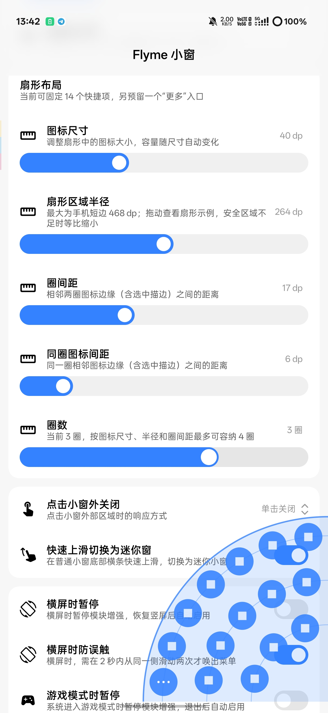

  

<h1 align="center">Flyme 小窗（FlymeFreeform）</h1>

  
  
  

魅族 Flyme 的小窗，将“呼之即来，挥之即去”做得轻巧又顺手。几次简单的滑动与轻点，便能处理眼前的小事，这份细腻的巧思让人愉悦。

本项目通过 Xposed 模块，将这份即用即走的快捷交互带到 ColorOS。

> **本仓库是 [Mangi-11/FlymeFreeform](https://github.com/Mangi-11/FlymeFreeform) 的派生分支。** 当前分支包含尚未合并到上游的本地更改，详见[「相对上游的更改」](#相对上游的更改)。

## 预览

<table align="center">
  <tr>
    <td align="center" width="50%">
      
    </td>
    <td align="center" width="50%">
      
    </td>
  </tr>
  <tr>
    <td align="center">交互预览</td>
    <td align="center">设置界面</td>
  </tr>
</table>

## 功能

- **快速唤出**：从左右下角斜向内上滑，呼出扇形菜单，滑选应用后松手以小窗打开。
- **窗外关闭**：支持单击或双击小窗外关闭，也可关闭此功能。
- **上滑迷你窗**：快速上滑普通小窗底部横条，切换为迷你小窗。
- **底部横条**：普通小窗底部横条加高、加粗，按下时有缩放反馈；单击发送系统返回键（可返回应用内上一页），双击关闭小窗。
- **快捷项管理**：应用、分身应用、侧边栏工具和快捷入口可混合固定，容量由扇形布局动态计算，支持拖动排序，与系统侧边栏的选择独立保存。分身应用需要智能侧边栏可用。
- **扇形布局**：可调整图标尺寸、扇形半径、圈间距、同圈图标间距与圈数；半径最大为手机短边，圈数上限自动计算，拖动滑块时显示实时示例。
- **App Shortcuts**：滑选普通应用或分身应用图标并悬停后显示该用户下的应用快捷操作，继续滑到对应操作上松手，以小窗启动；无快捷操作时保留原有应用启动行为，悬停时长可在设置中调整（100–2000 毫秒，默认 550 毫秒）。
- **手势设置**：左右入口独立开关，可调整角落触发范围。
- **隐藏系统侧边栏**：可隐藏智能侧边栏浮标并释放其占用的边缘手势区域（该功能默认关闭），模块依赖的侧边栏能力保持可用。
- **自动暂停**：默认在横屏或游戏模式下暂停增强，退出后自动恢复，可分别关闭。
- **防误触**：可分别开启横屏或游戏模式下的角落手势防误触，首次有效滑动提示“请再划一次”，2 秒内从同一侧再次滑动才唤出菜单。默认关闭，仅在对应的暂停功能关闭时可设置。

*更多功能持续开发中。*

## 相对上游的更改

本分支基于上游 [Mangi-11/FlymeFreeform](https://github.com/Mangi-11/FlymeFreeform) 开发，以下均为相对上游的本地更改，尚未合并到上游：

| 更改 | 说明 |
| --- | --- |
| 多圈扇形布局与动态容量 | 快捷项容量不再固定为六项，而是根据图标尺寸、扇形半径、圈间距与圈数动态计算；新增扇形布局设置，拖动滑块时显示实时示例。 |
| 同圈图标间距调节 | 扇形布局新增“同圈图标间距”，可单独调整同一圈内相邻图标之间的距离。 |
| App Shortcuts 悬停菜单 | 滑选普通应用或分身应用图标并悬停后显示应用快捷操作，继续滑到对应操作上松手，以小窗启动；悬停时长可调（100–2000 毫秒，默认 550 毫秒）。 |
| 横屏与游戏模式防误触 | 可分别开启横屏、游戏模式下的角落手势防误触：首次有效滑动提示“请再划一次”，2 秒内从同一侧再次滑动才唤出菜单。 |
| 小窗底部横条增强 | 加高底部 Frame、加粗横条并增加按压反馈；普通小窗横条单击返回（系统返回键）、双击关闭小窗，不影响上滑迷你窗与拖动缩放。 |
| 隐藏系统侧边栏界面 | 新增“隐藏系统侧边栏界面”开关：隐藏智能侧边栏浮标并将其边缘手势区域清零，同时保留 Smart Sidebar 的常驻服务与 Binder/Provider 能力，模块的“更多”面板、侧边栏工具与分身应用不受影响。 |

## 设计与实现

本项目借鉴 Flyme 的快捷交互，复刻扇形菜单的展开动画与滑选体验；“更多”窗口复用 ColorOS 智能侧边栏的“全部”面板，应用窗口继续由系统已有的自由窗能力管理。

完整照搬另一套系统的界面，容易造成视觉与操作上的割裂；另建一套小窗能力，也会增加系统适配与后续维护的成本。因此，我们保留 Flyme 的交互巧思，同时沿用 ColorOS 的界面与窗口能力，让这份体验自然融入当前系统。

## 致谢

- [Flyme](https://www.flyme.com/)：感谢其小窗细腻的设计与交互巧思。
- [libxposed API](https://github.com/libxposed/api)：现代 Xposed API。
- [Miuix](https://github.com/compose-miuix-ui/miuix)：UI 组件库。

## 许可证

本项目基于 GPL-3.0 开源，详情请参阅 [LICENSE](LICENSE)。
